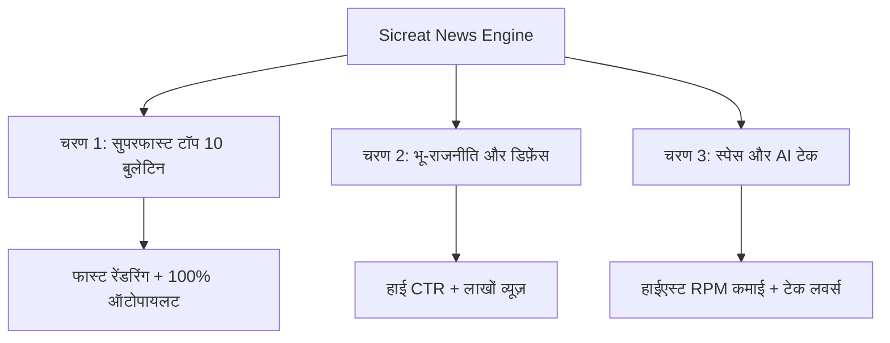

# 🎯 चैनल नीश रणनीति और रोडमैप (Content Niches & Strategy Roadmap)

यह दस्तावेज़ हमारे ऑटोमेशन सिस्टम के तहत तीनों चयनित न्यूज़ कैटेगरी (Niches) का मास्टर ब्लूप्रिंट है। हम इन्हें एक-एक करके (Step-by-Step) सेट और ऑटोमेट करेंगे।

---

## 📌 चयनित 3 मुख्य श्रेणियाँ (Selected Niches)

---

## 📅 लागू करने का क्रम (Implementation Roadmap)

### 🥇 चरण 1: सुपरफास्ट टॉप 10 बुलेटिन (दैनिक समाचार)
* **थीम:** दिनभर की 10 बड़ी खबरें / सुबह का मॉर्निंग बुलेटिन
* **वीडियो की लंबाई:** 5 से 7 मिनट (प्रत्येक खबर: 30-40 सेकंड)
* **अपलोड का समय:** सुबह 7:30 AM और शाम 8:00 PM
* **प्राथमिकता:** सबसे पहले इसे 100% ऑटोमेट करेंगे (सबसे आसान और टिकाऊ मॉडल)।
* **विस्तृत फाइल:** [`niches/01-daily-top10/blueprint.md`](file:///d:/Sicreat-automation/niches/01-daily-top10/blueprint.md)

---

### 🥈 चरण 2: भू-राजनीति & डिफ़ेंस (Geopolitics & Defense)
* **थीम:** भारत बनाम चीन/पाक, रूस-यूक्रेन, राफेल, नौसेना, विश्व कूटनीति
* **वीडियो की लंबाई:** 7 से 9 मिनट (गहन विश्लेषण / Case Study)
* **अपलोड का समय:** दोपहर 1:00 PM या शाम 6:00 PM (हफ़्ते में 3-4 वीडियो)
* **प्राथमिकता:** चरण 1 के स्थिर होने के बाद इसे शुरू करेंगे।
* **विस्तृत फाइल:** [`niches/02-geopolitics-defense/blueprint.md`](file:///d:/Sicreat-automation/niches/02-geopolitics-defense/blueprint.md)

---

### 🥉 चरण 3: स्पेस, साइंस & AI टेक (Space & AI Tech)
* **थीम:** ISRO मिशन (गगनयान, चंद्रयान), NASA, नए AI टूल्स, भविष्य की टेक्नोलॉजी
* **वीडियो की लंबाई:** 6 से 8 मिनट
* **अपलोड का समय:** ट्रेंडिंग टॉपिक या हफ़्ते में 2 विशेष वीडियो
* **प्राथमिकता:** प्रीमियम ऑडियंस और हाईएस्ट एड-रेवेन्यू (RPM) के लिए।
* **विस्तृत फाइल:** [`niches/03-space-ai-tech/blueprint.md`](file:///d:/Sicreat-automation/niches/03-space-ai-tech/blueprint.md)

---

## ⚙️ प्रोग्रामेटिक सेटिंग्स (Code Integration)
सभी नीश के कीवर्ड्स, विजुअल स्टाइल और टाइमिंग सेटिंग्स [`niches/niches.json`](file:///d:/Sicreat-automation/niches/niches.json) में सुरक्षित हैं, जिसे हमारा Node.js और Remotion इंजन सीधे पढ़ेगा।
